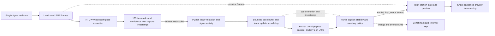

# Sign GPT Phase 2

For the current app and runtime, start with the [project Quickstart](../QUICKSTART.md). This folder contains pinned Uni-Sign setup, data and pose preparation, oracle and replay benchmarks, and scoring scripts. The original experiment plan follows. See the [benchmark summary](../BENCHMARKS.md) for completed results.

**Decision for approval.** Allocate up to **$10 and four billable Pod hours** for one frozen-checkpoint validation session. Use Uni-Sign pose-only How2Sign on a single Secure Cloud L40S. Stop at whichever limit comes first. Train a small boundary classifier only if human-marked clips translate adequately and the best inference-only policy still cuts at the wrong times. Reassess the model and pose path if clip translation itself fails. As of 26 November 2026, checkpoint files and code were verified from publisher sources. GPU runtime, translation quality and end-to-end latency remain open measurements. [Uni-Sign checkpoint](https://huggingface.co/ZechengLi19/Uni-Sign/blob/main/how2sign_pose_only_slt.pth) · [Runpod pricing](https://www.runpod.io/pricing)

## Architecture

Build in this order.

1. Extract pose from controlled recordings and run the same checkpoint on human-marked spans and real-time-paced continuous tracks. The bundle includes a Pod bootstrap, pose preparation, timestamp-paced replay, summarizer and conditional boundary training. Video preparation is a CPU ONNX stage. The first replay has poses already extracted, so its timestamps measure replay plus decoding. Time pose and the network separately, then instrument the live renderer for the full path.
2. For the eventual one-signer live prototype, use the same RTMW lightweight profile, single-person tracking and unmirrored model input. Keep x divided by frame width, y by frame height and the COCO-WholeBody point order with detector confidence. Prefer laptop pose extraction if the CPU meets the measured target. Use remote CPU pose on explicitly approved clips for reproducible offline tests. For an approved live raw-video comparison, use a separate private input path, no recording, and test remote pose throughput. The model consumes pose windows, so keep the translator and caption protocol identical across paths. [Vendored RTMW profile](https://github.com/ZechengLi19/Uni-Sign/blob/eed438bcb49e30405cd6ccdfcccca330c134e830/demo/rtmlib-main/rtmlib/tools/solution/wholebody.py) · [Official normalization](https://github.com/ZechengLi19/Uni-Sign/blob/eed438bcb49e30405cd6ccdfcccca330c134e830/demo/online_inference.py)
3. Use one warmed Python worker per demo GPU, one in-flight translation and at most one pending snapshot. Start with 500 ms updates, a 500 ms minimum active window, 250 ms pre-roll, an 8 s cap and greedy decode capped at 48 new tokens. Compare against the four-beam reference. Recompute bidirectional encoding as the window grows. Cache the extracted poses and use decoder caching within one generation. Extend caching across updates only after testing that the source and decoder state can be safely reused under the model's window normalization and attention. [Uni-Sign model](https://github.com/ZechengLi19/Uni-Sign/blob/eed438bcb49e30405cd6ccdfcccca330c134e830/models.py)
4. Start with a pose-motion cue and a visibility gate. Replace the current partial on each update and track the common word prefix. Commit once the same nonempty text appears twice and the source is quiet for at least 650 ms. The second inference-only policy also allows a stable punctuation mark with at least 350 ms of quiet. Commit to the last observed active source timestamp. An overflow or disconnect yields an uncertain segment and an explicit reset. Persistent signing without a clear break, fidgeting and time lost to false boundaries are acceptance cases.
5. The Tauri client eventually renders a provisional line and immutable final history. Share the captioned preview window into the meeting for the first remote-visible output. OBS Virtual Camera can composite video and local captions after validation. Run one physical camera owner and mirror only the preview. [OBS Virtual Camera](https://obsproject.com/kb/virtual-camera-guide)

### Cloud contract

Use a Pod-hosted Python ASGI service with a loopback-only listener and direct SSH forwarding for the authorized test. Suggested endpoints are `GET /healthz`, `GET /readyz`, and `WS /v1/sessions/{session_id}/poses`. Readiness requires the pinned checkpoint to load and pass warm-up. The service is a design deliverable in this phase. The included benchmarks execute directly on the Pod.

| Message | Minimum fields and behavior |
|---|---|
| Start | Protocol version, session ID, model/extractor revision, nominal FPS and unmirrored coordinate orientation. Allow one session per worker initially. |
| Pose chunk | Sequence number, relative monotonic capture timestamps and up to 500 ms of float32 landmarks and confidence. Shape per frame `[133,3]` in `x,y,score` order. Use binary framing and validate shape, finite values, size, timestamp order and age. Send zero-valued poses for unknown frames with an explicit validity flag. |
| Caption event | Kind `partial`, `final`, `uncertain` or `status`, session ID, event sequence, segment ID, revision, source watermark, relative source interval and text. Echo the latest input sequence to correlate rendering latency. |
| Reconnect | Start a new session with a clear buffer, preserve previously displayed finals and deduplicate by session plus segment ID. Surface connection loss and dropped data. |
| Deployment | Use SSH keys and a private tunnel for the controlled test. For any later external demo, use TLS, expiring per-session credentials and a limit on concurrent sessions and message size. Keep webcam frames, poses and captions out of operational logs by default. |

Open only direct SSH on the test Pod. The service would bind to `127.0.0.1:8765`. Port-forward the local client with `ssh -p POD_SSH_PORT -L 8765:127.0.0.1:8765 root@POD_HOST`. Avoid testing persistent sockets through an unauthenticated public HTTP proxy. Later local deployment starts by measuring the same RTMW profile on the laptop. Try CPU ONNX threading and a frame-cadence A/B before rewriting it in Rust. If translation needs to move local, test mT5 dynamic INT8, or a distilled commercially cleared model, against the same semantic and latency gates. Produce separate pose and translator profiles before choosing ONNX, an Intel CPU runtime or a CUDA-only backend. [Runpod SSH setup](https://docs.runpod.io/pods/configuration/use-ssh) · [Runpod port guidance](https://docs.runpod.io/pods/configuration/expose-ports)

## What changed after verification

| Report topic | Engineering consequence |
|---|---|
| The pose-only checkpoint's filename and revision were unclear. | Use `how2sign_pose_only_slt.pth`, revision `64a2e24003b6e6bdbafca4f24c5f387921cdc6f0`, with the SHA-256 enforced by the bootstrap. The paper's pose-only score is 14.5 BLEU-4 and 48.6 BLEURT. The report's 14.9 and 49.4 correspond to RGB plus pose. Neither pair measures the bundled prototype. [Artifact](https://huggingface.co/ZechengLi19/Uni-Sign/blob/main/how2sign_pose_only_slt.pth) · [Uni-Sign paper](https://arxiv.org/html/2501.15187v2#S4.T1) |
| The upstream demo provides online inference. | The demo reads the whole file and generates once. The adapter retains the upstream source computation and adds an opt-in source-only return to skip training loss. A GPU parity run compares exact output token IDs at the same settings before relying on it. [Demo](https://github.com/ZechengLi19/Uni-Sign/blob/eed438bcb49e30405cd6ccdfcccca330c134e830/demo/online_inference.py) |
| How2Sign keypoints and training splits are ready out of the box. | The public dataset's keypoints and the Uni-Sign pose archive require format checks. Upstream configuration points How2Sign at WLASL poses, leaves dev blank and routes test as dev in the trainer. This bundle uses independent manifests and direct pose conversion. Check archive coverage and time alignment before creating any adaptation examples. [Dataset docs](https://github.com/ZechengLi19/Uni-Sign/blob/eed438bcb49e30405cd6ccdfcccca330c134e830/docs/DATASET.md) · [Config](https://github.com/ZechengLi19/Uni-Sign/blob/eed438bcb49e30405cd6ccdfcccca330c134e830/config.py) · [Trainer](https://github.com/ZechengLi19/Uni-Sign/blob/eed438bcb49e30405cd6ccdfcccca330c134e830/fine_tuning.py) |
| ReSCUE availability and prefix supervision. | The repository remains a placeholder, as the report noted. Appendix F uses proportional truncation for video and text prefixes, along with trained silence behavior and stabilization. Adopt bounded retranslation and commitment as design ideas. Use human-aligned complete targets for supervised sentence windows. Its average lagging metric cannot validate webcam-to-render latency. StreamSLST has code and remains a follow-on research option. [ReSCUE paper](https://arxiv.org/html/2610.03022v1#A6) · [ReSCUE repo](https://github.com/Tabiiiqwq/ReSCUE) · [StreamSLST](https://arxiv.org/abs/2611.00055) |
| SHuBERT as a quality comparator. | Its public encoder and stronger published offline How2Sign result make it a comparator. Anonymous access to the complete downstream stack remains unverified, and the author Space expects a token. Use the hosted demo only on its own examples or shareable material with approval. Treat Uni-Sign's OpenASL score cautiously because the SHuBERT paper identifies substantial pretraining overlap with that test set. [SHuBERT paper](https://aclanthology.org/2025.acl-long.1397.pdf) · [Author demo source](https://huggingface.co/spaces/ShesterG/TTIC-SHuBERT-ASLVideo-to-EnglishText/blob/main/app.py) |
| Model, data and code rights. | How2Sign and the Uni-Sign weights are labeled CC BY-NC 4.0, and OpenASL is CC BY-NC-ND 4.0. The Uni-Sign source distribution terms need separate verification before sharing or integrating its code into a product. Commercial model, data, source and extractor rights require their own clearance. [How2Sign terms](https://how2sign.github.io/#download) · [Uni-Sign model card](https://huggingface.co/ZechengLi19/Uni-Sign) · [Uni-Sign source](https://github.com/ZechengLi19/Uni-Sign) · [OpenASL terms](https://github.com/chevalierNoir/OpenASL/blob/main/LICENSE.md) |

## Validation and spending gates

Use a small pilot of four continuous tracks to set the activity cutoff and choose between 5 s and 8 s buffers and pause-only versus stable-punctuation commitment. Keep the acceptance material separate from tuning. Target eight uninterrupted 20–45 s tracks across at least three consenting ASL signers, with at least 24 manually marked meaning units. Include short and long turns, consecutive sentences with limited pauses, turns with pauses inside a sentence, gaze or hand occlusion, finger spelling, names, numbers and negation. Record two idle or fidgeting tracks totaling at least 60 s. Use a qualified ASL reviewer, ideally a second reviewer on disagreements. If this coverage cannot be achieved within the schedule, call the result a pilot and keep the wider decision open.

1. **Pre-spend.** Confirm noncommercial research scope, signer consent and a small authorized input set. Check the console rate, direct SSH, data center, volume plan and dollar/time caps. Keep the official test split and acceptance set sealed until the policy is chosen. Record hashes and review templates before launching.
2. **Checkpoint and oracle.** Confirm imports, one visible BF16 GPU, checkpoint SHA-256, strict load, and source-only token parity over at least five representative clips with the four-beam settings. Compare the same webcam recordings cut at human-marked boundaries. The proposed bar is at least **18 of 24** units judged meaning-preserving, with zero sign reversals or consequential errors in numbers, names or negation. If this fails, compare publisher poses and webcam poses or re-check framing before changing model or training. The optional 32 published How2Sign test clips are a format/domain check and produce a descriptive SacreBLEU signature on a small subset.
3. **Continuous replay.** On the same held-out material, aim for at least **22 of 24** correctly attributable finals, no more than **three** fewer meaning-preserved units than the oracle, and zero final captions on the idle tracks. Require p95 first useful caption within **3.5 s** from manual signing onset, p95 final within **2.5 s** after manual signing end, and zero premature finals. Log missing timings separately and treat them as misses. Require p95 model work below **400 ms** at 500 ms cadence, per-track replay work RTF at or below **0.8**, at most **5%** skipped scheduled updates and normalized token erasure at or below **0.30**. These are proposed acceptance thresholds for this experiment, not model claims. Report per-signer results and counts.
4. **Live demo.** Instrument both first useful and final events at the actual Tauri render time on the same client clock used for capture. Log capture/pose, upload and download, server queue, normalization, encoder/generation and render delay. Include pose processing FPS, effective input FPS, dropped frames, GPU peak allocated/reserved and process/device use sampled by `nvidia-smi`. At the configured live pose cadence, require sustainable pose FPS and rerun the replay gates with real render timing. Test one 15-minute single-session reconnect case. This is a controlled demonstration gate, not accessibility or product validation.

Caption meaning uses preserved, partial, wrong or missing. Preserve names, negation, agency and quantities in the reviewer rubric. The first useful caption must communicate an identifiable part of the intended meaning. Compute final latency from source end to the matching immutable caption, and record a negative value as premature. Caption stability counts deleted suffix words divided by introduced words and reports revisions per source minute. Distinguish model-work real-time factor from elapsed replay duration. Measure cold start separately from warmed updates. Raw replay captions and human references stay in restricted experiment files.

## Conditional training

**First adaptation candidate.** Train the boundary classifier only when the oracle passes and review identifies boundary timing as the dominant error after inference-only tuning. Leave the complete Uni-Sign model frozen. Keep RTMW, normalization and decoding unchanged. The learned head changes the commit evidence and still requires plausible activity, at least 200 ms of quiet, and two matching nonempty hypotheses. It cannot repair semantic failures or commit when the signer never pauses.

| Setting | First experiment |
|---|---|
| Data | Up to 40 frontal full recordings from official How2Sign train, up to 10 from official validation, seeded 42 across source recordings. Group by signer when identities are available, otherwise by source recording and explicitly report that signer overlap is possible. Keep whole streams and their derived windows together. Prefer a processed continuous archive only if it demonstrably covers the actual gaps. With the published sentence archive alone, obtain selected continuous sources from How2Sign or use a separate consented train/dev collection. Never infer pauses from an absence of pose files. [How2Sign downloads and manually realigned timestamps](https://how2sign.github.io/#download) |
| Preprocessing | Join the official manually realigned start and end times to the original frontal video ID, preserve inter-sentence gaps, and verify durations and a few annotated boundaries against original frames. Convert selected 20–45 s time ranges to constant fps at 25 or 30 without changing timestamps, rebase the annotations, and extract RTMW poses. For clips with no full frame coverage or ambiguous IDs, report and skip before sealing the manifest. Add a separately identified idle negative subset. |
| Target and model | Four causal pose features from the preceding 850 ms. Label observation times 200–700 ms after a real sentence end positive, using 100 ms nominal sampling and negatives from the remaining timeline. Use a 4→16→1 ReLU classifier with weighted BCE, capping positive class weight at four. All translator and pose extractor components remain frozen. |
| Hyperparameters | FP32, AdamW, learning rate 0.001, weight decay 0.01, batch 128 sampled windows, 300 steps, seed 42. Save atomically every 50 steps and select validation window F0.5, threshold grid 0.4–0.8. Use the checkpoint only if paired held-out replay shows better boundary timing with no semantic or idle-final regression. |
| Compute | The head is CPU-sized. Plan a few minutes once prepared poses exist and budget up to one Pod hour for a controlled CUDA smoke, resume and paired replay. One L40S session can reuse the resident checkpoint. Time extraction, training and replay separately. No translator training VRAM is needed for this head. |

If the oracle passes but correctly timed partials systematically hallucinate, route to a **separately approved** projection-only experiment. Freeze RTMW, GCNs, mT5 encoder and decoder weights, and the untied output head. Train just `pose_proj` (787,200 parameters) through mT5 using up to 1,024 eligible official-train spans, 128 actual validation spans, no test data, and independently marked source intervals. Mix complete-window pairs with complete sentences plus a short incomplete continuation, labeling only the completed sentence. To train earlier captions on a current partial, obtain human-reviewed recoverable English content for visual prefixes. Baseline experiment settings are BF16 autocast with FP32 trainable weights, AdamW at 2e-4, weight decay 0.01, microbatch one, accumulation 16, clip norm 1, maximum 256 frames/50 target tokens, up to 128 optimizer steps, evaluation/checkpoint every 32 and seed 42. Run ten steps and measure before extending. Reserve 12–30 GiB as a planning range and 2–6 GPU-hours for setup, training and evaluation, about $2.18–$6.54 at the listed rate. Gradients still flow through the frozen mT5. Exact memory and training time depend on frame length and GPU measurements. If projection-only underfits, reconsider rank-8 q/v LoRA in the 12 mT5 decoder cross-attention blocks. QLoRA, full ReSCUE reproduction and retraining from scratch add no value to the first gate. See the model notes for the exact target regex and projected trainable count. The included runnable trainer is for the boundary head.

## Roadmap after approval

| Time | Parallel work | Dependencies and stop point |
|---|---|---|
| 0–24 h | Prepare consented recordings and reference labels, verify storage and direct SSH, and check the caption event contract with mock input. | Start the authorized Pod only once inputs and cost are confirmed. Run import/strict-load/parity and pilot oracle samples. If pilot oracle quality is poor, investigate camera-to-pose parity or available fallback before spending on streaming training. |
| 24–48 h | Pilot pause/cap/beam settings, finish review of held-out spans and prepare a private mock transport. | Freeze settings before opening holdout. Run paced replay on the same webcam material. Decide between frozen deployment, boundary-only training or fallback from observed errors. |
| 48–72 h | Run a bounded private live test and, if justified, a paired boundary-head A/B on holdout. | Proceed only after the preceding gates and authorized spend. Record scorecard, export artifacts and shut down. A captioned preview integration is the goal for a later app milestone. |

**Fallback.** If full webcam clips translate acceptably and incremental streaming fails, use explicit signer-controlled start/commit with one complete-caption decode. It exchanges responsiveness for a reliable source boundary. If the checkpoint fails semantically, check Sign-Speak's ASL WebSocket pilot using the same held-out material after confirming access, rate, video consent, data terms and partial/final semantics. WebRTC availability requires vendor confirmation. Its headline accuracy and inference costs cannot be inferred from the public integration guide. [Sign-Speak SDK](https://github.com/Sign-Speak-Development/sign-speak-react-sdk#websocket-real-time-asl-recognition) · [Vendor API guide](https://app.theneo.io/sign-speak/sign-speak-api/api-specifications/asl-production)

## Budget

The public Secure L40S rate used here is **$1.09/h** on 26 November 2026. Confirm the console quote before provisioning. Figures below are estimates in USD before tax, based on billable time including setup and review runs. [Runpod GPU pricing](https://www.runpod.io/pricing) · [Pod and storage billing](https://docs.runpod.io/pods/pricing)

| Cost | Optimistic | Realistic | Pessimistic |
|---|---:|---:|---:|
| Setup and validation compute | 4 h / $4.36 | 8 h / $8.72 | 12 h / $13.08 |
| Conditional boundary training and recovery | CPU / $0 | 1 h / $1.09 | 3 h / $3.27 |
| Conditional projection trial | $0 | $0 | 8 h / $8.72 |
| Interactive inference after validation | 1 h / $1.09 | 6 h / $6.54 | 20 h / $21.80 |
| Storage allowance | $1.00 | $3.00 | $6.00 |
| **Total** | **$6.45** | **$19.35** | **$52.87** |

The pessimistic scenario includes multiple sessions and requires separate authorization. An always-on L40S would cost roughly $785 in GPU time for 30 days, plus storage. Start and stop interactive inference around test sessions. Consider a 24 GB card only after observing a combined GPU peak at or below 18 GiB and retesting latency there. Approve additional spend only after oracle quality passes, the timing traces indicate a specific tractable limit, and the next comparison has a defined stop rule.

## Runbook and evidence

- [RunPod commands, dataset manifests and recovery](RUNBOOK.md)
- [Model and training source checks](research/model.md)
- [Streaming source checks](research/streaming.md)
- [Laptop inventory and infrastructure source checks](research/infrastructure.md)
